# One task, from a request to an app

This page follows one task through everything the studio does: from the first request, through
changes, comparisons, a faster model and a better search, to an app someone else runs on their own
data. Each step says three things:

- **You do**: what you click or type.
- **What happens**: what the agent and the studio do with it.
- **What you see**: what the screen shows afterwards.

The screenshots are from one real session. Yours will differ in the details: the agent writes its
own model each time, so the views, the heuristic and the numbers are not the same twice. The
labels on the screen are in English; write to the agent in any language.

## The task

A workshop has four workers, each with some of three skills (assembly, inspection, packing), and
eighteen tasks for the week, each taking some hours and needing one skill. Every task goes to a
worker who has its skill, and the busiest worker should finish as early as possible.

The data is in `docs/guide/walkthrough/`, to follow along with:

| File | What it holds |
|---|---|
| [`workers.csv`](walkthrough/workers.csv) | each worker's name and skills |
| [`tasks.csv`](walkthrough/tasks.csv) | each task's name, hours and skill |
| [`current-plan.csv`](walkthrough/current-plan.csv) | a plan made by hand: which worker takes each task |
| [`tasks-next-week.csv`](walkthrough/tasks-next-week.csv) | another week's tasks, for the app |
| [`workers-next-week.csv`](walkthrough/workers-next-week.csv) | that week's workers, with a skill added |

| Step | What it shows |
|---|---|
| [1. Hand over the data and ask](#1-hand-over-the-data-and-ask) | attaching files, the agent's tools, the first revision |
| [2. Read the result](#2-read-the-result) | the Result, Model and Runs tabs |
| [3. Change the task](#3-change-the-task) | a new rule, a new revision, the Revision menu |
| [4. Compare two revisions](#4-compare-two-revisions) | the Compare tab |
| [5. Compare heuristics](#5-compare-heuristics) | several heuristics in one solve |
| [6. Start from your own plan](#6-start-from-your-own-plan) | scoring a plan and improving on it |
| [7. Port the model to Rust](#7-port-the-model-to-rust) | the Port to Rust button, a verified port |
| [8. Let the agent improve the search](#8-let-the-agent-improve-the-search) | a benchmark, a campaign, the Improve tab |
| [9. Make it an app](#9-make-it-an-app) | `app.json`, the Package button |
| [10. Use the app](#10-use-the-app) | what the app's user does, without the agent |
| [11. Bring a case back](#11-bring-a-case-back) | a case exported from the app, read in the studio |
| [12. Hand it over](#12-hand-it-over) | exporting a project, a Docker image, another agent |

It assumes the studio is running ([Getting started](getting-started.md)). The screen has a
header, the chat on the left and the canvas on the right; [The interface](interface.md) lists
every control.

## 1. Hand over the data and ask

**You do.** Click **New project** in the header. Click **+** next to the message box and choose
`workers.csv` and `tasks.csv`; each shows as a chip above the box. Write what the files are and
what you want, and press **Enter** (or **Send**):

> These are our workshop's workers with their skills, and this week's tasks with the hours each
> takes and the skill it needs. Assign every task to a worker who has its skill, so that the
> busiest worker finishes as early as possible. Show each worker's tasks and hours.

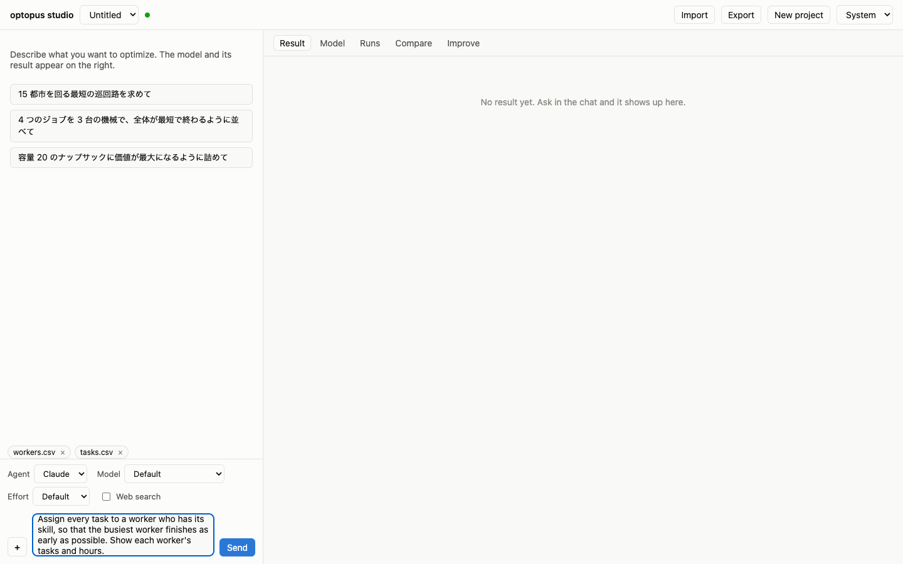

**What happens.** The files are stored in the project's `uploads/` folder as soon as you choose
them, and the message the agent gets starts with their names (`Attached: workers.csv,
tasks.csv`). The agent then works through the studio's tools, one line in the chat for each:

```
▸ preview_upload workers.csv     reads the columns and the first rows of a file
▸ preview_upload tasks.csv
▸ import_upload workers.csv      copies the rows into instance.json
▸ import_upload tasks.csv
▸ read_docs problems             reads optopus's guide: which kind of problem fits
▸ read_docs python_problems
▸ write_file model.py            writes the problem
▸ write_file solve.json          writes how to search
▸ write_file view.py             writes what the canvas draws
▸ api_help TabuSearch            looks up the exact arguments of a heuristic
▸ check_model                    builds the model and tries the search for up to 2 seconds
▸ run_solver                     solves, and makes revision 1
```

- **The data becomes part of the project.** `import_upload` puts the rows into `instance.json`,
  and the model reads only that file, never `uploads/`. A revision therefore solves the same way
  later, whatever happens to the file you attached
  ([ADR 0004](../adr/0004-import-uploads-into-the-instance.md)).
- **The agent chooses how to write the problem**: one of optopus's built-in problems, a
  `Formula`, or a problem written in Python, the first that fits. Here the objective is a
  maximum (the busiest worker's hours), which neither of the first two can state, so it wrote
  the problem in Python, with the moves the search makes: give a task to another worker, swap
  two tasks.
- **`check_model` runs the files before anything is shown.** It builds the model, runs the
  heuristic for at most two seconds and draws the views, in a process of its own. When it reports
  an error the agent fixes the files and checks again. It makes no revision and changes nothing
  on the canvas.
- **`run_solver` makes a revision.** The studio starts the solver in a separate process, shows
  each run's progress as it comes, and then copies the files next to their result as revision 1.
  A revision never changes afterwards.

When something that changes the model is unclear, such as a column's unit, the agent asks one
short question in the chat instead of guessing; answer it there. Here it needed none: it read
`assembly;inspection` in the `skills` column as two skills on its own.

**What you see.** While the agent works, **Send** is **Stop**, which interrupts it (what it
already wrote stays), and the canvas says "Building the model…". The project takes its name from
your first message. When `run_solver` ends, the canvas shows revision 1 and the agent sums it up
in a few lines.

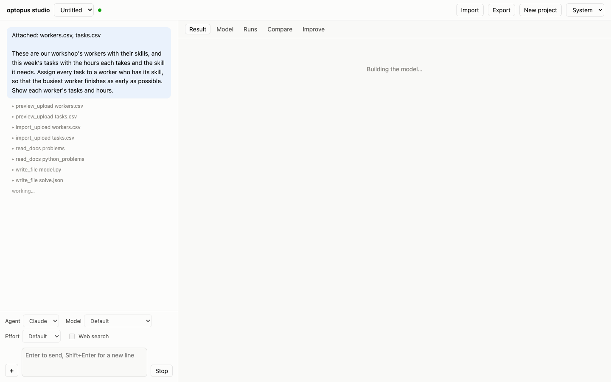

## 2. Read the result

**You do.** Look through the three tabs above the canvas: **Result**, **Model** and **Runs**.

**What you see.** **Result** shows, from the top:

- a blue banner, because this problem is written in Python ([step 7](#7-port-the-model-to-rust));
- **the views** the agent's `view.py` made for this task: the headline numbers (the busiest
  worker has 12 hours, which is also the least possible: 48 hours of work for four workers), a
  table of each worker's tasks, a Gantt chart with a lane per worker and a color per skill, and a
  bar chart of the hours;
- **Convergence**: the best objective each run has found so far, against time or, with the toggle
  on the chart, iterations. A curve still falling at its end means more search would help;
- **Heuristic**: how it searched. Here a tabu search over the "Reassign" moves, three runs with
  seed 0, each stopping at 3,000 iterations or 5 seconds.

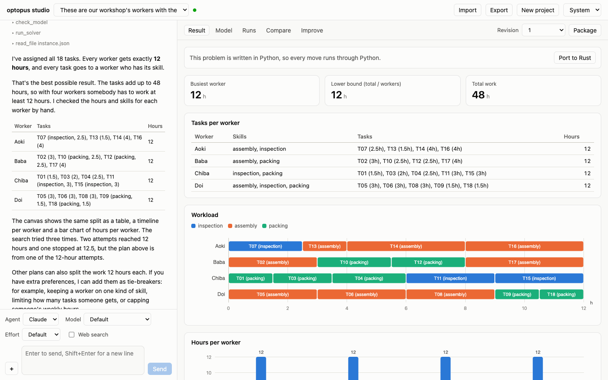

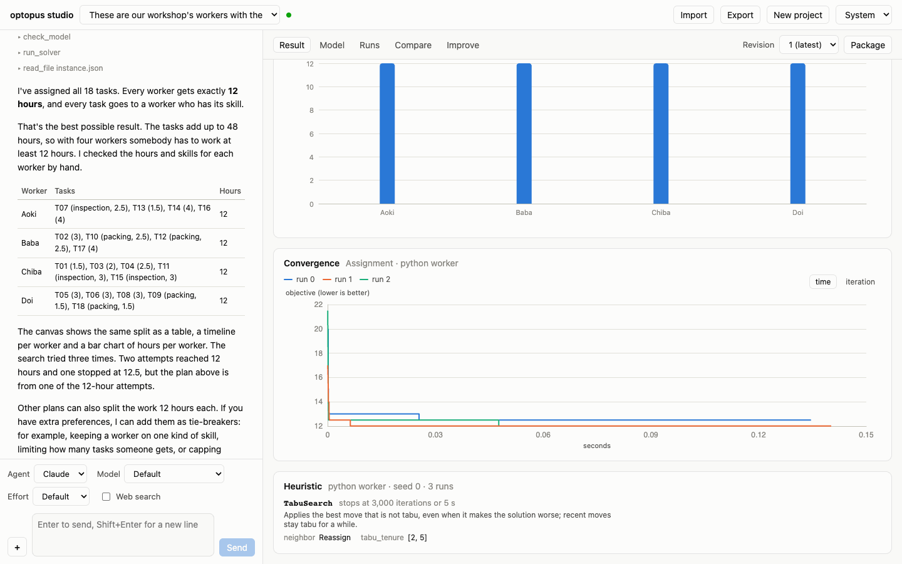

**Model** shows the files of the revision: `model.py`, `view.py`, `instance.json` and
`solve.json`. They are read-only; to change one, ask the agent.
[Projects, revisions and files](projects.md#the-files) says what each is.

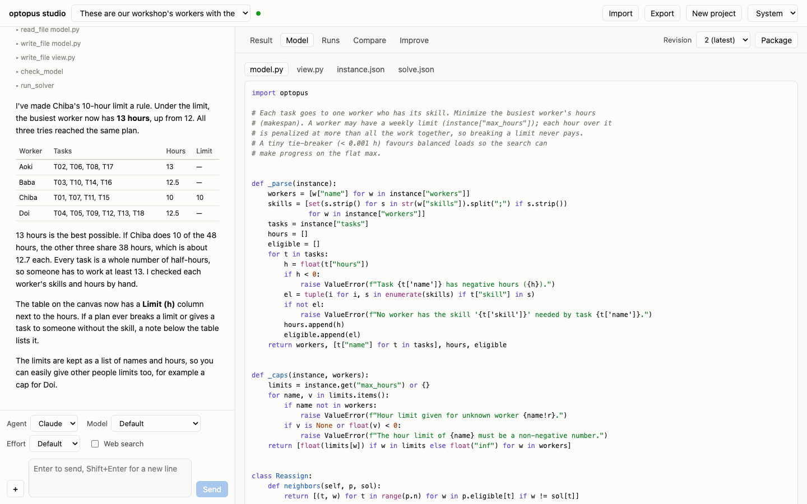

**Runs** shows the heuristic again and a row per run: its best and initial objective, the
iterations, when the best was found, and the seed. The best run is in bold. Here two runs of
three ended at 12 hours and one at 12.5, so more than one run was worth it.

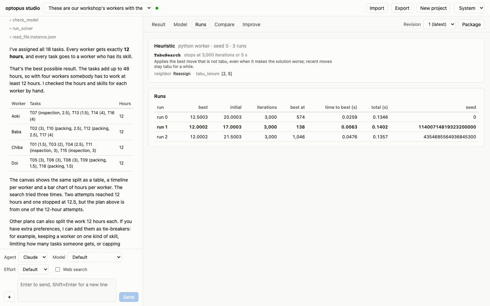

**What happens.** Nothing is computed when you change tabs: a revision holds its result and its
views, and the canvas only shows them. The objective reads 12.0002 rather than 12 because the
agent added a tiny term that prefers even loads, to give the search a slope where the maximum is
flat; the views report the hours themselves.

## 3. Change the task

**You do.** Ask for the change in plain words:

> Chiba works part-time and can take at most 10 hours this week. Make that a rule, and show each
> worker's limit next to their hours.

**What happens.** The agent changes only what the request needs, then checks and solves again:

```
▸ write_file instance.json       adds the limit to the data
▸ read_file model.py
▸ write_file model.py            an hour over a limit costs more than any gain could pay
▸ write_file view.py             adds the Limit column, and a note of any rule broken
▸ check_model
▸ run_solver                     makes revision 2
```

A rule the solution's form does not enforce by itself becomes a penalty large enough that
breaking it never pays, and the view reports any violation, so you can see that none is left.

**What you see.** Revision 2: the busiest worker now has 13 hours, and Chiba 10. The
**Revision** menu above the canvas lists both revisions, the newest marked "(latest)". Choosing
revision 1 shows its files, result and views again. It only shows them: the agent always carries
on from the latest files, so to go back to an earlier model, tell the agent which change to undo.

## 4. Compare two revisions

**You do.** Open **Compare**. The two menus at its top choose the revisions.

**What you see.**

- **Best objective**: the change between the two, marked better, worse or the same. Here it says
  "worse, +1 (8.3%)": the new rule costs an hour. The mark compares the numbers only; whether the
  task itself changed, as it did here, is yours to judge.
- **Headline numbers**: the numbers of both revisions' views, row by row.
- **Convergence of the best runs**: one curve per revision.
- **Changed files**: a line diff of every file that differs.

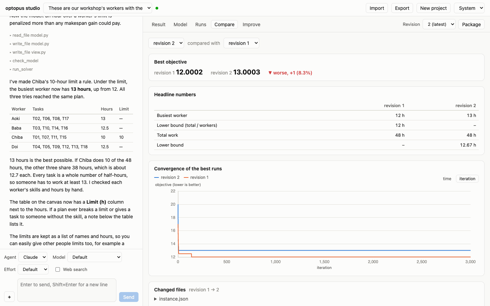

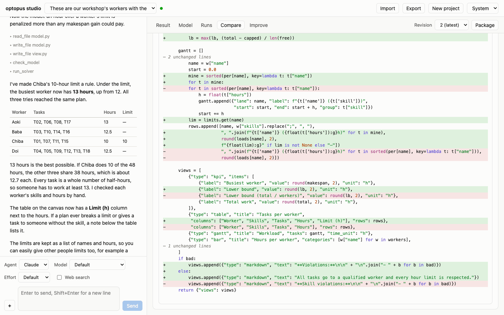

**What happens.** The canvas fetches both revisions and compares them in the page; nothing is
solved. A revision that changes only `view.py` or `app.json` solves the same as the one before
it, so the first comparison skips past such revisions and says which.

## 5. Compare heuristics

**You do.** Ask which search method suits the problem:

> Which search method suits this? Compare simulated annealing, tabu search and late acceptance
> hill climbing, 5 runs each.

**What happens.**

```
▸ api_help SimulatedAnnealing
▸ api_help LateAcceptanceHillClimbing
▸ write_file solve.json          lists three heuristics, each with a label
▸ check_model
▸ run_solver                     makes revision 3
```

`solve.json` now holds `"heuristics"`, a list, instead of one `"heuristic"`. Each runs five times
with the same seeds, so all three start from the same solutions and differ only in how they
search.

**What you see.** **Convergence** overlays the three, a color per heuristic, and the
**Heuristics** card lists each with its settings. **Runs** adds a table with each heuristic's
best, mean and worst result and its mean times.

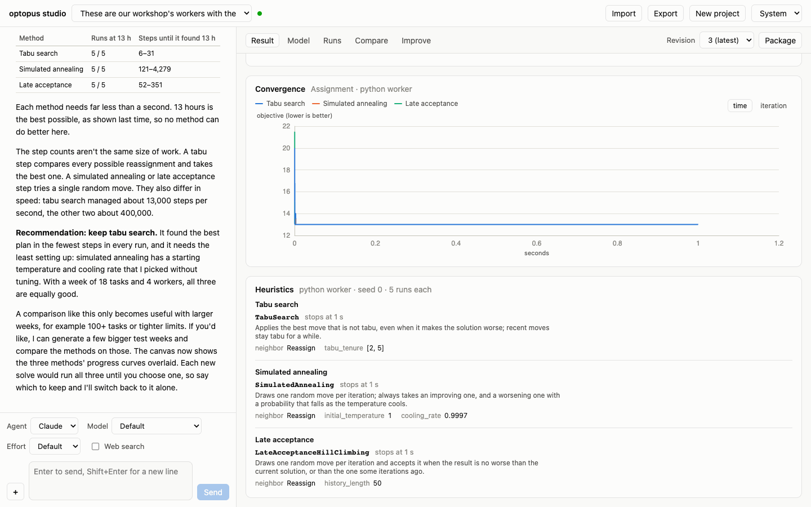

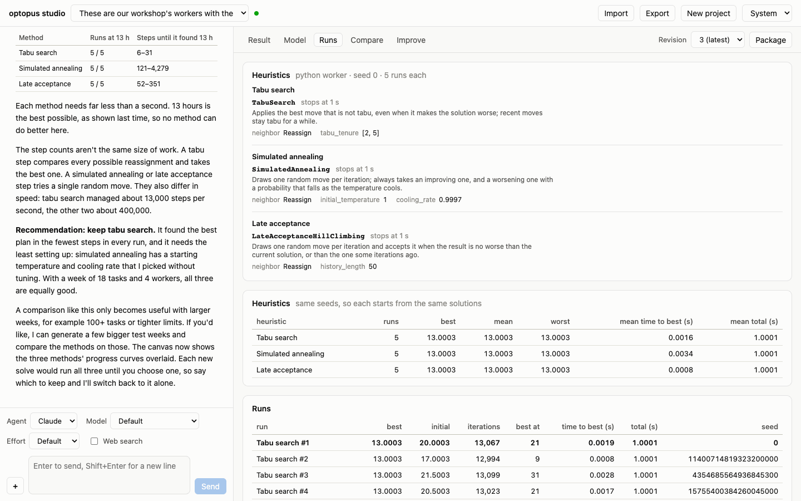

Here all three reach 13 hours in every run: on eighteen tasks the choice makes no difference,
and the agent says so. A comparison on one small instance cannot tell more, which is what
[step 8](#8-let-the-agent-improve-the-search) is for.

## 6. Start from your own plan

**You do.** Attach `current-plan.csv` with **+** and ask:

> Keep tabu search alone. This is the plan I made by hand: start from it, and tell me how much
> the search improves on it.

**What happens.**

```
▸ preview_upload current-plan.csv
▸ import_upload current-plan.csv   the plan goes into instance.json
▸ write_file model.py              reads a plan in the file's form
▸ write_file solve.json            "initial_solution": "current_plan"
▸ write_file view.py               shows your plan next to the result
▸ check_model
▸ run_solver                       makes revision 4
```

Every run starts from a random solution unless `solve.json` names one in `instance.json`. With
`"initial_solution"`, each run starts from your plan, so its initial objective is what your plan
scores and its best objective how far the search got from there
([ADR 0011](../adr/0011-start-from-a-solution-in-the-instance.md)). A plan that does
not fit the problem, such as a task given to a worker without its skill, stops the solve at the
start and says why. The same mechanism continues from an earlier result: ask to "keep going from
revision 3".

**What you see.** The plan made by hand has a busiest worker of 14 hours and the search brings
it to 13. The **Heuristic** card says "starts from instance.current_plan", and the **Runs** tab
shows 14 as every run's initial objective. The views are the agent's: here it added your plan's
hours to the table and the bar chart, and a list of the tasks that moved.

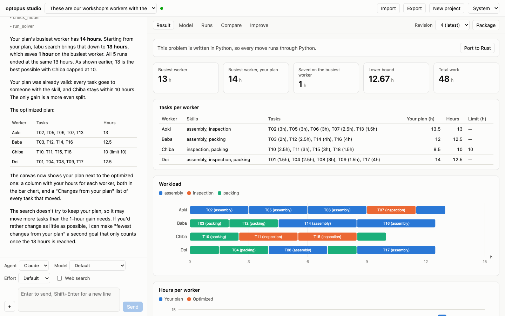

## 7. Port the model to Rust

**You do.** Click **Port to Rust** in the blue banner on the Result tab.

**What happens.** The button sends a message for you: "Port this model to Rust, verify it against
the Python model, and switch to the Rust worker if it passes." The agent then:

```
▸ rust_guide                     reads how a Python problem becomes Rust
▸ write_file rust/main.rs        writes the same model in Rust
▸ build_rust                     compiles it, and reads the compiler's errors
▸ verify_rust                    runs both workers with the same seeds
▸ write_file solve.json          "worker": "rust"
▸ run_solver                     makes revision 5
```

A problem written in Python calls Python for every move, thousands a second. The port is the
same model compiled, and `verify_rust` is what makes it safe to use: it checks that the port
gives the Python model's solutions exactly the same objective, that it searches as well, that
`view.py` draws its result, and how much faster it is. Only a port that passes is switched to.
`model.py` stays in the project as the reference; after a change to it the agent changes the
port the same way and verifies again
([ADR 0005](../adr/0005-rust-worker-as-a-verified-port.md)).

The first build on a machine also compiles optopus itself, so it takes longer than the later
ones. A built-in problem or a `Formula` already searches in Rust and shows no banner.

**What you see.** The banner is gone, and **Convergence** and **Heuristic** say "rust worker". In
this session the port ran about 587,000 iterations a second against 13,000 in Python. On
eighteen tasks that changes nothing in the answer; it matters when the instances grow, as they do
next.

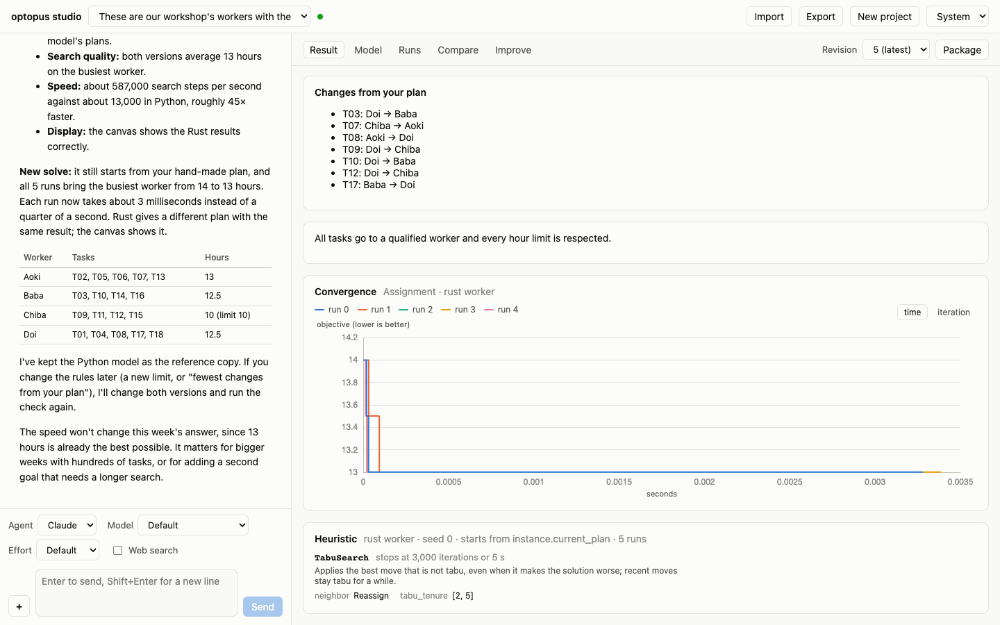

## 8. Let the agent improve the search

**You do.** Say what the search should become good at, how long the agent may work on it, and
how long one solve may take:

> Next quarter we will plan the whole plant with this: about 12 workers and 150 tasks a week, a
> few of the workers part-time. Improve the search on your own on weeks of that size, for 3
> rounds; a solve may take 2 seconds.

Then open **Improve** and watch. **Stop** ends the campaign early. To let the agent also look
up methods on the web, tick **Web search** under the chat before you send; it is off by default.

**What happens.** One solve of one instance says little about a search: a change can win by
luck, or fit that instance only. So the agent first builds a **benchmark**, and then hands the
loop to the studio, which runs a **campaign**
([ADR 0019](../adr/0019-drive-the-improvement-loop-from-the-studio.md)). The lines, abridged:

```
▸ write_file generate.py         makes weeks of the size you asked for
▸ bench_add plant_s1             an instance of the benchmark (seven in all)
▸ bench_settings                 5 runs per instance, 2 seconds each
▸ run_solver                     revision 6, the search the campaign starts from
▸ improve_start                  hands the loop to the studio
studio: Improvement campaign, round 1 of 3
▸ diagnose                       where the current search falls short
▸ read_docs recipes              methods reported to work on this kind of problem
▸ profile                        several heuristics side by side on the benchmark
▸ candidate_save                 one change, with the hypothesis it tests (four times)
▸ race                           the candidates against revision 6, with the same seeds
▸ candidate_lesson               what each result taught
studio: Improvement campaign, round 2 of 3
  …
▸ adopt                          the winner is solved into a new revision
studio: The campaign ended after 3 rounds and 11 minutes
```

- **The benchmark** has three kinds of instances. Changes are raced on the **train** ones. The
  **validation** ones are kept for the final check, and the **test** ones only measure the end
  result; no choice is ever made on those. Here the agent wrote `generate.py` to make weeks of
  the size asked for, since one small week is too little to judge on.
- **A round is the studio's, not the agent's.** The lines starting with `studio:` are the
  studio's own messages to the agent: where the campaign stands, the ledger of what was tried,
  and what the round is to do. Click one to read it. The agent takes one turn per round.
- **In a round** the agent diagnoses the current search, saves three or four changes of
  different kinds as **candidates**, each with the hypothesis it tests, and races them. Every
  candidate and the current revision solve every train instance with the same seeds and the
  same budget, and a paired test gives each candidate a verdict: better, mixed, same, worse,
  rejected or failed ([what they mean](projects.md#improving-the-algorithm)).
- **Only a candidate judged better can be adopted**, and adopting solves it into a new revision.
  The budget replaces each heuristic's own stop, so a change cannot win by running longer, and
  the current revision's model scores the candidate's solutions again, so a change cannot win
  by changing what is optimized.
- **The campaign ends** when its rounds or minutes are spent, when three rounds in a row bring
  nothing, or when you press **Stop**. The studio then checks the result itself: the final
  revision against the one it started from, on the validation instances. It keeps the
  improvement only if it holds there, and otherwise makes the files the starting revision's
  again.

**What you see.** The **Improve** tab follows along, with a progress bar while a race or a
diagnosis runs. During round 1 it showed the benchmark, the campaign's state, the first
diagnosis with its readings, and the profile:

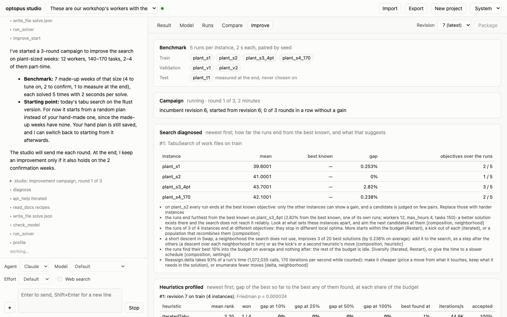

This session went as follows, and it shows why the judging matters more than the ideas:

- **Round 1** raced four changes: a longer tabu memory, an iterated tabu search, simulated
  annealing, and a variable neighborhood search. All four came out "same". The lessons the
  agent recorded say why: on these weeks every method reached the same hours within
  milliseconds, and so did 17 of the current search's 20 runs, so the benchmark could not tell
  one search from another.
- **Round 2**: the agent therefore made the benchmark harder first (weeks where few workers
  share a skill, tasks of a quarter of an hour), and three candidates were then judged better.
  The best, an iterated tabu search sized for 150 tasks, was adopted as revision 8.
- **Round 3** raced three changes on revision 8. None was better, so nothing was adopted.
- **The final check**: revision 8 against revision 6 was better on validation (+2.74%) and the
  same on test (+0.23%), so the studio kept it.

When the campaign ends, the tab's **Campaign** line gives the outcome, and **Hypotheses** lists
every candidate with its kind, the revision it changes, the race it ran in, what became of it,
its gain and the lesson the agent drew:

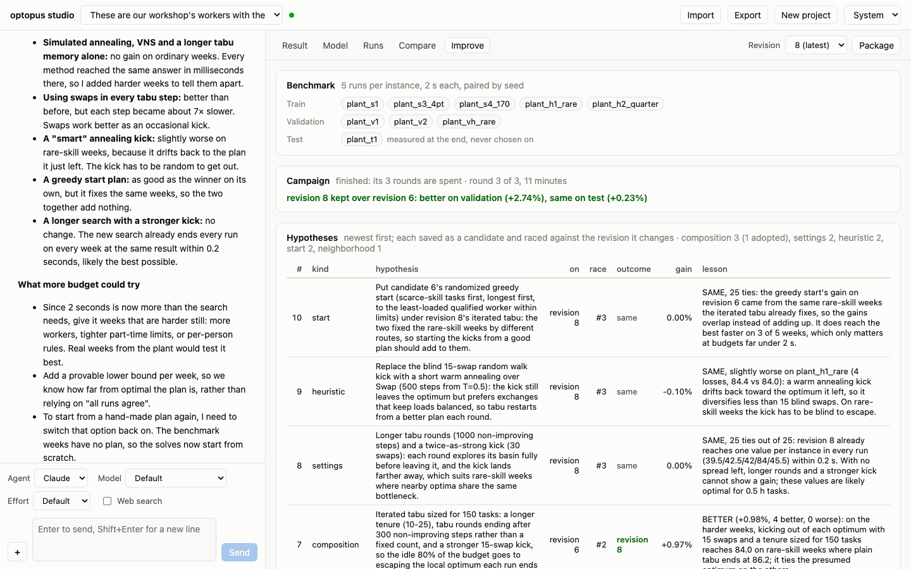

**Changes judged**, further down, has a row per evaluation with its verdict and how many
instances got better, stayed and got worse; click one for each instance. The two rows at its
top are the studio's own final check.

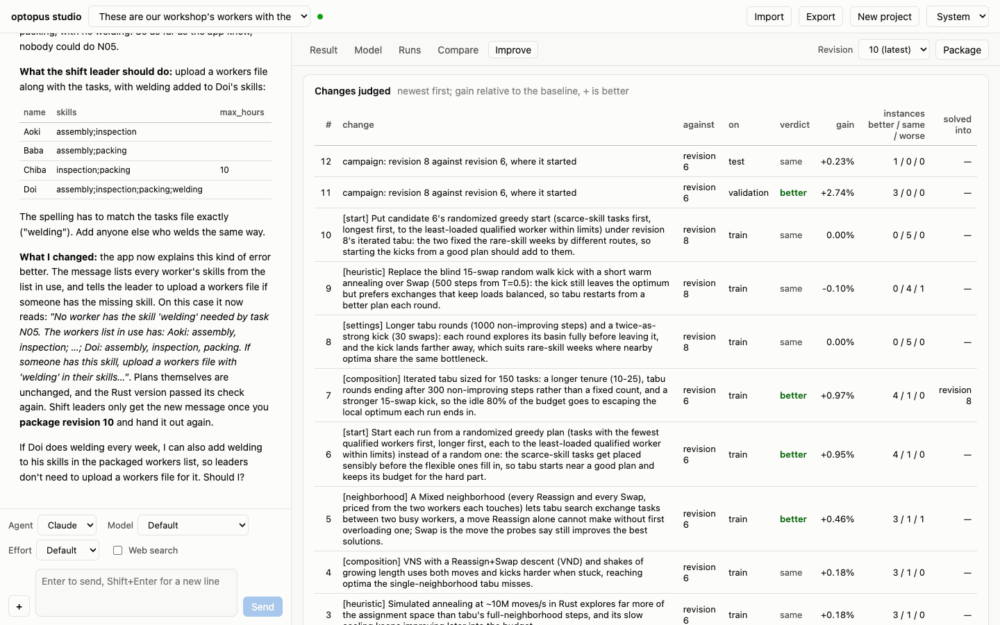

The agent ends with a summary in your terms: how much the search improved and on which
instances, what got it there, and what did not help and why. Not every new revision is an
improvement: revision 7 here is the solve that put six heuristics side by side for the profile.
[Improving the algorithm](projects.md#improving-the-algorithm) explains tuning, profiles and
diagnoses in detail, and [The interface](interface.md#improve) every column of the tab.

## 9. Make it an app

**You do.** Say who will use it, what they bring and what they may set:

> Make this an app for the shift leaders: each week they upload that week's tasks, and the
> workers when they change, and they can set how many seconds a solve may take.

When the agent has finished, select the revision it names in the **Revision** menu (the latest,
unless you solved again since) and click **Package**.

**What happens.**

```
▸ write_file model.py            checks the data it is given, and says what is wrong with it
▸ write_file rust/main.rs        the same change in the port
▸ build_rust
▸ write_file instance.json       the limits move into the workers table
▸ write_file view.py
▸ write_file app.json            what the app's user may replace and set
▸ check_app                      app.json against the data and the settings
▸ check_model
▸ verify_rust                    the port still matches the Python model
▸ write_file solve.json          one run per solve
▸ check_app
▸ run_solver                     revision 9, which holds app.json
```

`app.json` names the **inputs**, tables of `instance.json` the app's user may replace with a
file of their own, each with the columns it must have, and the **parameters**, single values
they may set, each with its limits. Everything else stays as packaged. Since the app's user
cannot ask the agent why a solve failed, the agent also makes `model.py` check what it assumes
of the data and say what is wrong in the user's terms. Here it moved the part-time limits into
a `max_hours` column of the workers table too, so a shift leader changes them in the same file.

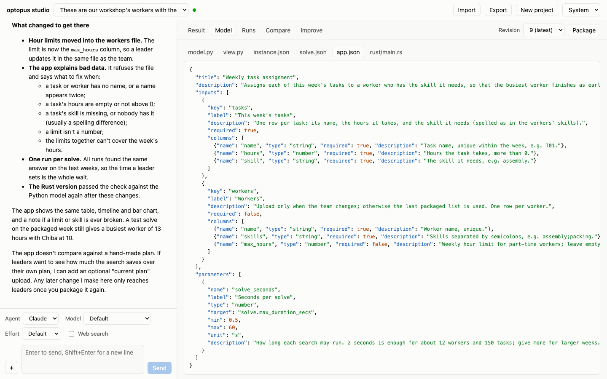

**Package** downloads `optopus-app-<project>-r<rev>.zip`: the revision's files, and its own
result as a sample. A revision without `app.json`, or one whose `app.json` does not fit it,
gives a yellow "Cannot package revision N" banner instead, which says why
([ADR 0009](../adr/0009-package-a-revision-as-an-app.md)).

**What you see.** The zip in your downloads folder (Safari unpacks it into a folder, which
works as well). From a checkout of this repository it runs without the agent or a login:

```bash
uv run optopus-studio app optopus-app-<project>-r<rev>.zip   # http://127.0.0.1:8766
```

## 10. Use the app

This step is the shift leader's, at the address above. There is no chat and no agent.

**You do.** The app opens with the result on the packaged data, to show what to expect. Under
**Data**, click **Choose file** on "This week's tasks" and give
[`tasks-next-week.csv`](walkthrough/tasks-next-week.csv). (The app's title, labels and
descriptions are the ones the agent wrote in `app.json`.) Set **Seconds per solve** under
**Settings** if you wish, and click **Solve**.

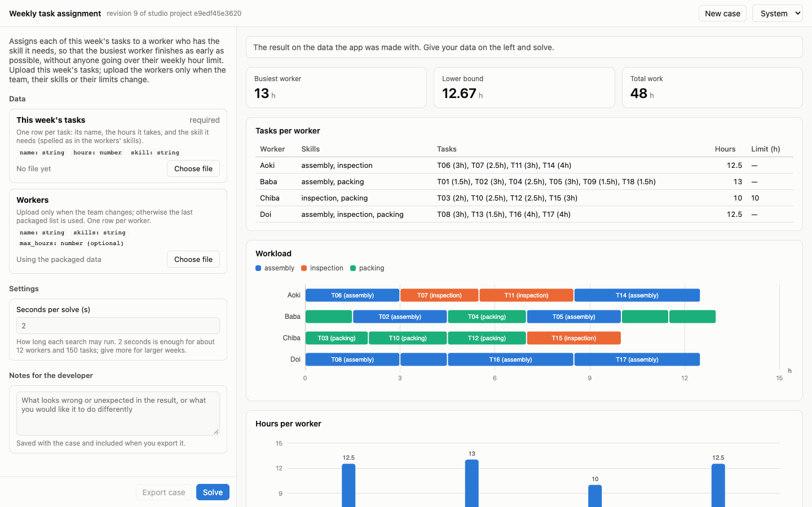

**What happens.** The app reads the file as the studio's `import_upload` would, puts its rows in
place of the packaged table, applies the settings, and solves with the packaged model and
search, in a process of its own. Before it solves it checks each file against the columns
`app.json` lists; a missing column or an empty or malformed cell is reported with its rows,
under "These inputs cannot be solved as they are". An input you do not give keeps the packaged
data: here, the workers.

**What you see.** This week has a welding task, and no worker in the packaged list welds. The
model's own check stops the solve and says so, in the words the agent gave it:

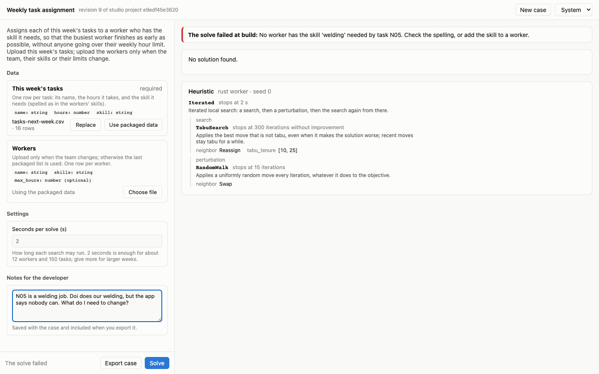

The shift leader knows that Doi welds, but not what to change. They write that under **Notes
for the developer** and click **Export case**, which downloads `optopus-case-<id>.zip`: the
files they gave, the settings, what the app made of them, and the note. They send you the zip.
Nothing else leaves their machine; their cases stay there, and **New case** starts another.

## 11. Bring a case back

**You do.** Back in the studio, attach the case's zip with **+**, like any file; its chip reads
`case:<id>`. Ask:

> A shift leader sent this case from the app. What went wrong?

**What happens.**

```
▸ read_case                      where the case came from, what failed, the data and the note
▸ load_case                      puts the case's data in place of the project's
▸ check_model                    reproduces the failure
▸ restore_revision               back to the files of revision 9
▸ write_file model.py            a clearer message for this kind of data
▸ write_file rust/main.rs
▸ build_rust
▸ load_case
▸ check_model                    the case now fails with the new message
▸ write_file instance.json       puts the packaged data back
▸ verify_rust
▸ check_app
▸ run_solver                     revision 10
```

The case is stored in the project's `cases/` folder. `read_case` tells the agent which revision
the app was packaged from and what the app refused or how the solve failed, and `load_case`
makes the project's data the case's, so the agent sees the same failure the app's user saw. It
then tells you whether the data or the model is at fault. A case that solved but whose note
says the result is not what was expected is feedback rather than a failure: the agent works
out which requirement the model misses and confirms it with you before changing anything.

**What you see.** Here the answer is that the data is at fault, and which: the tasks file is
right, but the app fell back on the packaged workers, among whom nobody welds. The shift leader
has to upload a workers file with `welding` among Doi's skills
([`workers-next-week.csv`](walkthrough/workers-next-week.csv)). The agent also made the message
say so itself next time, which is revision 10.

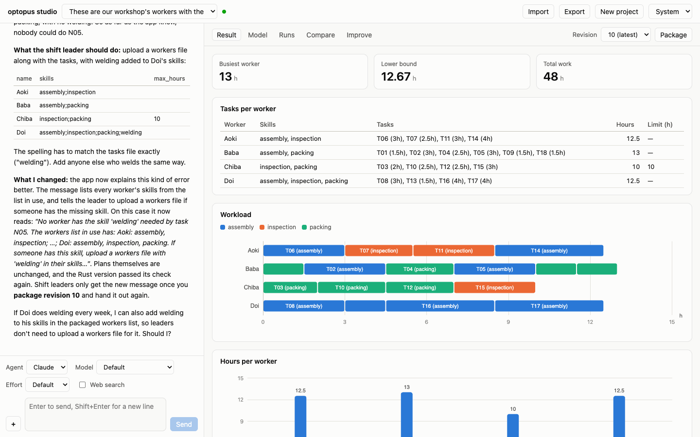

A fix reaches the app's users only when its revision is packaged again and handed out. Back in
the app, the shift leader gives the workers file as well, and the week solves:

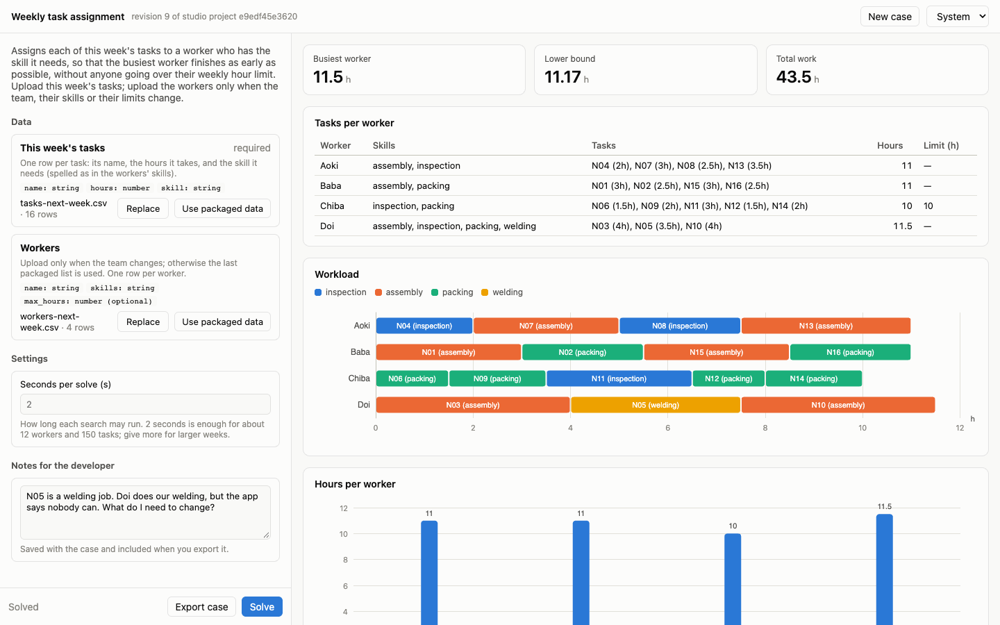

## 12. Hand it over

Three ways to pass the work on, by who receives it.

**To a colleague who will carry on in the studio.** Click **Export** in the header. It downloads
the project as one zip: the chat, every revision with its result and views, the attached files,
and the benchmark with everything judged on it. They click **Import** and choose the zip, which
adds it as a new project marked "(imported)". The agent's session stays on the machine it ran
on, so their agent starts a new one that reads the conversation first
([ADR 0007](../adr/0007-share-a-project-as-a-zip.md)).

**To someone with this repository but no agent.** The package from [step 9](#9-make-it-an-app),
run with `uv run optopus-studio app <zip>`. It needs no Claude Code or Codex login.

**To a customer with neither.** Build the package into a Docker image, which holds the app, the
solver and the built Rust port, and no agent
([ADR 0010](../adr/0010-deliver-an-app-as-a-docker-image.md)):

```bash
uv run optopus-studio image optopus-app-<project>-r<rev>.zip --save app-r<rev>.tar
```

The customer loads and runs it with Docker alone; the
[README](https://github.com/trash-iine/optopus-studio/blob/main/README.md#handing-an-app-to-a-customer) has the commands. Their cases stay on
their machine, and reach you only as the files they export.

The agent itself can change hands too. The **Agent** menu under the chat switches the project
between Claude and Codex while the agent is idle; the other agent reads the conversation so far
with its next message and carries on from the project's files. **Model** and **Effort** choose
what the agent runs on, from the list the agent itself gives.

## Where everything is kept

Everything above is on your machine, under `~/.optopus-studio/projects/<id>/` (or
`OPTOPUS_STUDIO_HOME`):

| Folder | Holds | Written in |
|---|---|---|
| `uploads/` | the files you attached | steps 1 and 6 |
| `work/` | the files the agent is editing | every step |
| `revs/<n>/` | each solve: the files as solved, with `result.json` and `view.json` | every `run_solver` |
| `bench/` | the benchmark, the candidates, and every evaluation, tuning, profile and diagnosis | step 8 |
| `cases/<id>/` | cases attached from an app | step 11 |
| `chat.jsonl` | the conversation | every message |

## What next

- [The interface](interface.md): every control on the screen, including the ones this page
  passed by.
- [Projects, revisions and files](projects.md): the files in detail, and
  [how a change of the search is judged](projects.md#improving-the-algorithm).
- [Troubleshooting](troubleshooting.md): when a step here does not go as described.
