# 1 つの課題を、依頼からアプリまで

> この文書は[英語版](../../guide/walkthrough.md)の翻訳です。食い違う場合は英語版が正です。

このページでは、1 つの課題を通して studio でできることをすべてたどります。最初の依頼から、変更、比較、
モデルの高速化、探索の改善を経て、他の人が自分のデータで動かすアプリになるまでです。各ステップでは
次の 3 つを説明します。

- **操作**: 何をクリックし、何を入力するか。
- **起きること**: それを受けてエージェントと studio が何をするか。
- **画面に出るもの**: その後の画面に何が表示されるか。

スクリーンショットは実際の 1 回のセッションのものです。エージェントは毎回自分でモデルを書くので、
ビュー、ヒューリスティック、数値といった細部はセッションごとに変わります。画面上のラベルは英語のままで、
このページでも英語のラベルで呼びます。スクリーンショットのチャットは英語ですが、エージェントには
どの言語で書いても構いません。

## 課題

ある工房に 4 人の作業者がいて、それぞれ 3 つの技能(assembly、inspection、packing)のいくつかを
持っています。今週のタスクは 18 個で、それぞれに所要時間と必要な技能が 1 つあります。すべてのタスクを
その技能を持つ作業者に割り当て、最も忙しい作業者ができるだけ早く終わるようにします。

同じ手順を試せるように、データを `docs/guide/walkthrough/` に置いてあります。

| ファイル | 中身 |
|---|---|
| [`workers.csv`](../../guide/walkthrough/workers.csv) | 作業者の名前と技能 |
| [`tasks.csv`](../../guide/walkthrough/tasks.csv) | タスクの名前、時間、技能 |
| [`current-plan.csv`](../../guide/walkthrough/current-plan.csv) | 手で作った計画。どのタスクを誰が担当するか |
| [`tasks-next-week.csv`](../../guide/walkthrough/tasks-next-week.csv) | 別の週のタスク。アプリで使う |
| [`workers-next-week.csv`](../../guide/walkthrough/workers-next-week.csv) | その週の作業者。技能を 1 つ加えてある |

| ステップ | 分かること |
|---|---|
| [1. データを渡して頼む](#1-データを渡して頼む) | ファイルの添付、エージェントのツール、最初のリビジョン |
| [2. 結果を読む](#2-結果を読む) | Result、Model、Runs の各タブ |
| [3. 課題を変える](#3-課題を変える) | 新しい規則、新しいリビジョン、Revision メニュー |
| [4. 2 つのリビジョンを比べる](#4-2-つのリビジョンを比べる) | Compare タブ |
| [5. ヒューリスティックを比べる](#5-ヒューリスティックを比べる) | 1 回の求解で複数のヒューリスティック |
| [6. 自分の計画から始める](#6-自分の計画から始める) | 計画の採点と、そこからの改善 |
| [7. モデルを Rust に移植する](#7-モデルを-rust-に移植する) | Port to Rust ボタン、照合済みの移植 |
| [8. 探索の改善をエージェントに任せる](#8-探索の改善をエージェントに任せる) | ベンチマーク、キャンペーン、Improve タブ |
| [9. アプリにする](#9-アプリにする) | `app.json`、Package ボタン |
| [10. アプリを使う](#10-アプリを使う) | アプリの利用者がエージェント無しで行うこと |
| [11. ケースを持ち帰る](#11-ケースを持ち帰る) | アプリからエクスポートしたケースを studio で読む |
| [12. 渡す](#12-渡す) | プロジェクトのエクスポート、Docker イメージ、別のエージェント |

studio が起動していることが前提です([はじめに](getting-started.md))。画面はヘッダー、左のチャット、
右のキャンバスからなります。すべての部品は[画面の説明](interface.md)にあります。

## 1. データを渡して頼む

**操作。** ヘッダーの **New project** をクリックします。メッセージ欄の横の **+** をクリックして
`workers.csv` と `tasks.csv` を選ぶと、それぞれが欄の上にチップとして表示されます。ファイルが何で、
何をしたいかを書き、**Enter**(または **Send**)で送ります。

> These are our workshop's workers with their skills, and this week's tasks with the hours each
> takes and the skill it needs. Assign every task to a worker who has its skill, so that the
> busiest worker finishes as early as possible. Show each worker's tasks and hours.
>
> (これは工房の作業者とその技能、今週のタスクとその所要時間・必要な技能です。すべてのタスクを
> その技能を持つ作業者に割り当て、最も忙しい作業者ができるだけ早く終わるようにしてください。
> 作業者ごとのタスクと時間を見せてください。)

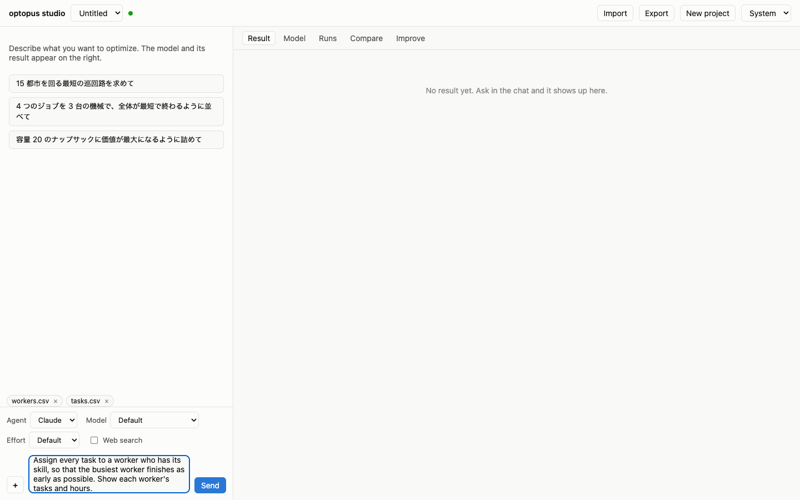

**起きること。** ファイルは選んだ時点でプロジェクトの `uploads/` フォルダに保存され、エージェントが
受け取るメッセージはファイル名で始まります(`Attached: workers.csv, tasks.csv`)。エージェントは
studio のツールを使って作業し、ツール 1 つにつきチャットに 1 行が出ます。

```
▸ preview_upload workers.csv     ファイルの列と先頭の行を読む
▸ preview_upload tasks.csv
▸ import_upload workers.csv      行を instance.json に取り込む
▸ import_upload tasks.csv
▸ read_docs problems             optopus のガイドを読む: どの種類の問題が合うか
▸ read_docs python_problems
▸ write_file model.py            問題を書く
▸ write_file solve.json          探索のしかたを書く
▸ write_file view.py             キャンバスに描くものを書く
▸ api_help TabuSearch            ヒューリスティックの引数を正確に調べる
▸ check_model                    モデルを組み立て、探索を最大 2 秒試す
▸ run_solver                     求解し、リビジョン 1 を作る
```

- **データはプロジェクトの一部になります。** `import_upload` が行を `instance.json` に入れ、モデルは
  そのファイルだけを読みます。`uploads/` は読みません。そのため、添付したファイルが後でどうなっても、
  リビジョンは同じように解けます([ADR 0004](../../adr/0004-import-uploads-into-the-instance.md))。
- **問題の書き方はエージェントが選びます。** optopus の組み込み問題、`Formula`、Python で書いた問題の
  うち、最初に合うものです。ここでは目的関数が最大値(最も忙しい作業者の時間)で、前の 2 つでは
  表せないため、Python で書きました。探索が行う手(タスクを別の作業者に移す、2 つのタスクを
  入れ替える)も一緒に書きます。
- **`check_model` は、何かを表示する前にファイルを実行します。** モデルを組み立て、ヒューリスティックを
  最大 2 秒動かし、ビューを描きます。これは専用のプロセスで行われます。エラーが出ればエージェントが
  ファイルを直して再度確かめます。`check_model` はリビジョンを作らず、キャンバスも変えません。
- **`run_solver` がリビジョンを作ります。** studio はソルバーを別のプロセスで起動し、各ランの進み具合を
  届いた順に表示し、最後にファイルと結果をまとめてリビジョン 1 として保存します。リビジョンは
  その後変わりません。

列の単位のように、モデルが変わるような不明点があると、エージェントは推測せずにチャットで短い質問を
1 つします。そこで答えてください。今回は質問はありませんでした。`skills` 列の `assembly;inspection` を
2 つの技能として自分で読み取りました。

**画面に出るもの。** エージェントが作業している間、**Send** は **Stop** になり、押すと中断します
(それまでに書いたものは残ります)。キャンバスには "Building the model…" と出ます。プロジェクト名は
最初のメッセージから付きます。`run_solver` が終わるとキャンバスにリビジョン 1 が表示され、
エージェントが数行でまとめます。

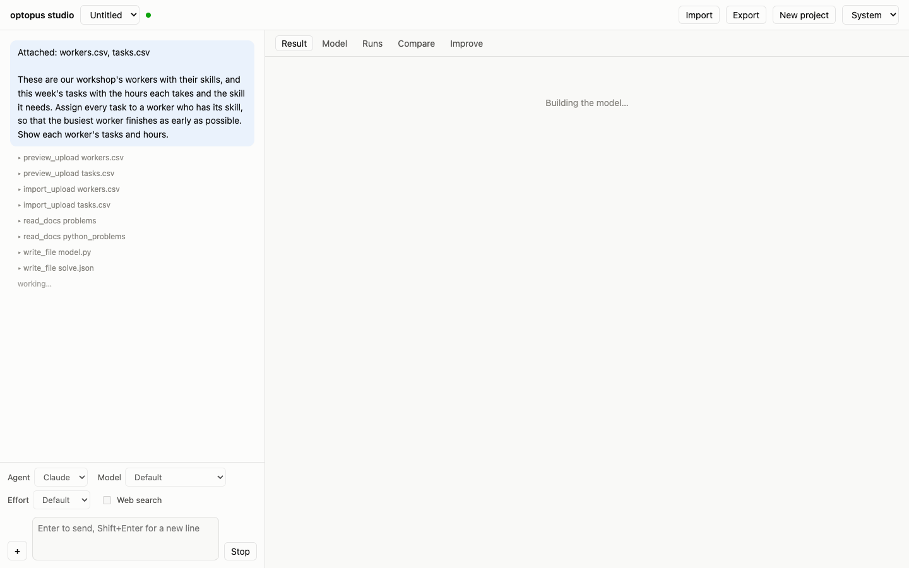

## 2. 結果を読む

**操作。** キャンバス上部の 3 つのタブ、**Result**・**Model**・**Runs** を見ていきます。

**画面に出るもの。** **Result** には上から順に次のものが並びます。

- 青いバナー。この問題が Python で書かれているためです([ステップ 7](#7-モデルを-rust-に移植する))。
- エージェントの `view.py` がこの課題のために作った**ビュー**。主要な数値(最も忙しい作業者は 12 時間。
  48 時間の作業を 4 人で分けるので、これが下限でもあります)、作業者ごとのタスクの表、作業者ごとの
  レーンと技能ごとの色を持つガントチャート、時間の棒グラフです。
- **Convergence**(収束): 各ランがその時点までに見つけた最良の目的関数値。横軸は時間で、グラフ上の
  切り替えで反復回数にできます。終わりでもまだ下がっている曲線は、もっと探索すれば良くなることを
  示します。
- **Heuristic**: どう探索したか。ここでは "Reassign" の手によるタブーサーチで、シード 0 の 3 ラン、
  それぞれ 3,000 反復か 5 秒で止まります。

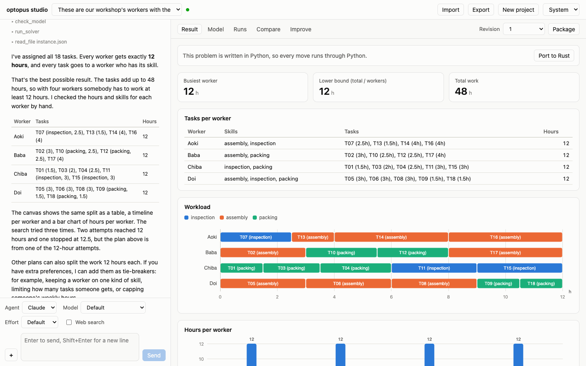

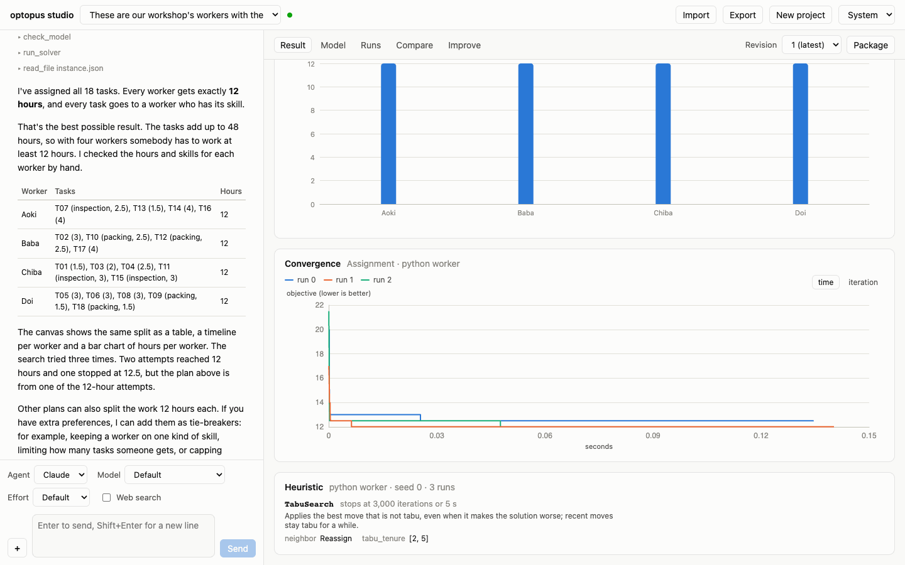

**Model** にはリビジョンのファイル、`model.py`・`view.py`・`instance.json`・`solve.json` が表示されます。
読み取り専用で、変えたいときはエージェントに頼みます。それぞれの意味は
[プロジェクト・リビジョン・ファイル](projects.md#ファイル)にあります。

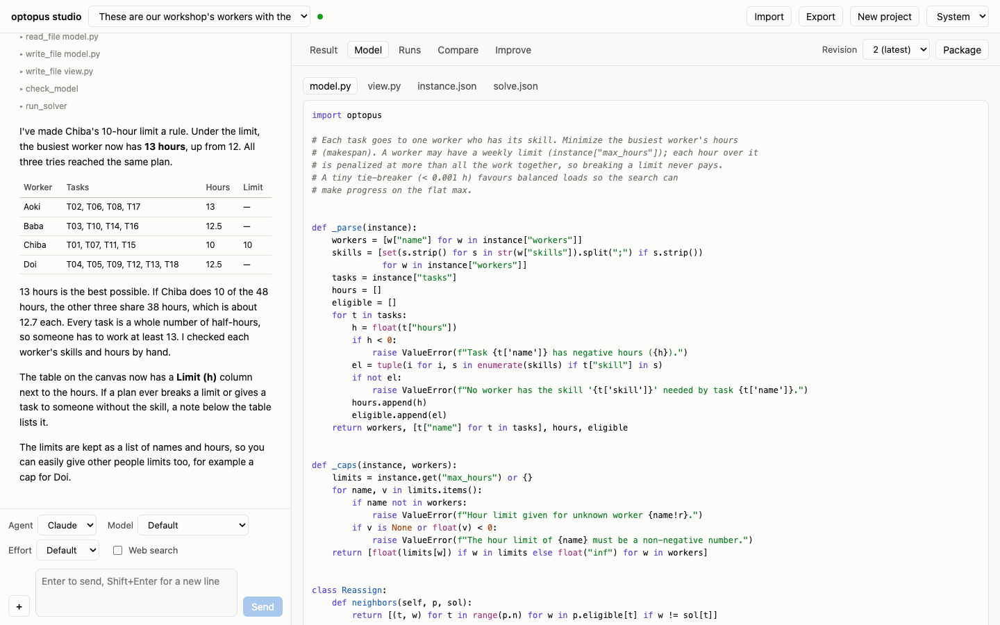

**Runs** には、ヒューリスティックがもう一度と、ラン 1 回につき 1 行の表が出ます。最良値と初期値、
反復回数、最良値を見つけた時点、シードです。最良のランは太字です。ここでは 3 ランのうち 2 つが
12 時間、1 つが 12.5 時間で終わったので、複数回走らせた意味がありました。

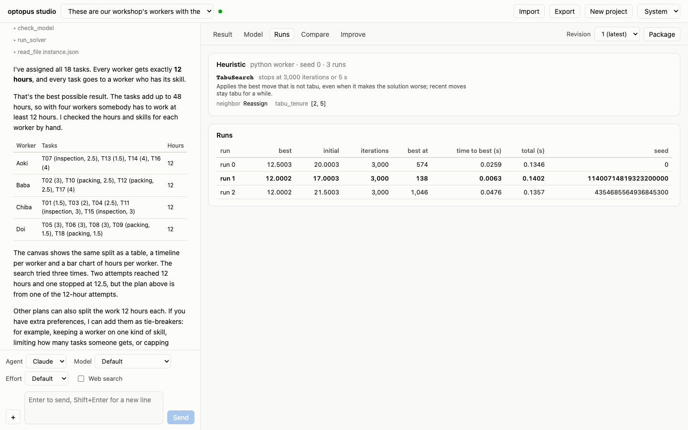

**起きること。** タブを切り替えても何も計算されません。リビジョンは結果とビューを持っていて、
キャンバスはそれを表示するだけです。目的関数値が 12 ではなく 12.0002 なのは、エージェントが、負荷が
均等なほうを好むごく小さな項を加えたためです。最大値が平らなところでも探索が進む向きを持てるように
するもので、ビューには時間そのものが表示されます。

## 3. 課題を変える

**操作。** 変えたいことを普通の言葉で頼みます。

> Chiba works part-time and can take at most 10 hours this week. Make that a rule, and show each
> worker's limit next to their hours.
>
> (Chiba はパートタイムで、今週は 10 時間までです。これを規則にして、作業者ごとの上限を時間の
> 横に表示してください。)

**起きること。** エージェントは頼まれたことに必要な部分だけを変え、確かめて、解き直します。

```
▸ write_file instance.json       データに上限を加える
▸ read_file model.py
▸ write_file model.py            上限を 1 時間超えると、どんな改善よりも高くつく
▸ write_file view.py             Limit の列と、破られた規則の注記を加える
▸ check_model
▸ run_solver                     リビジョン 2 を作る
```

解の形そのものが保証しない規則は、破っても決して得にならない大きさのペナルティになります。ビューが
違反を報告するので、違反が残っていないことを確かめられます。

**画面に出るもの。** リビジョン 2 です。最も忙しい作業者は 13 時間、Chiba は 10 時間になりました。
キャンバス上部の **Revision** メニューに両方のリビジョンが並び、最新のものには "(latest)" が付きます。
リビジョン 1 を選ぶと、そのファイル・結果・ビューがまた表示されます。表示するだけです。エージェントは
常に最新のファイルから作業を続けるので、以前のモデルに戻したいときは、どの変更を取り消すかを
エージェントに伝えます。

## 4. 2 つのリビジョンを比べる

**操作。** **Compare** を開きます。上部の 2 つのメニューでリビジョンを選びます。

**画面に出るもの。**

- **Best objective**: 2 つの間の変化。better(良くなった)、worse(悪くなった)、same(同じ)の
  いずれかが付きます。ここでは "worse, +1 (8.3%)" です。新しい規則のぶん 1 時間増えました。この印は
  数値だけを比べたものです。今回のように課題そのものが変わったのかどうかは、自分で判断します。
- **Headline numbers**: 両方のリビジョンのビューの主要な数値を、行ごとに。
- **Convergence of the best runs**: リビジョンごとに 1 本の曲線。
- **Changed files**: 異なるファイルすべての行単位の差分。

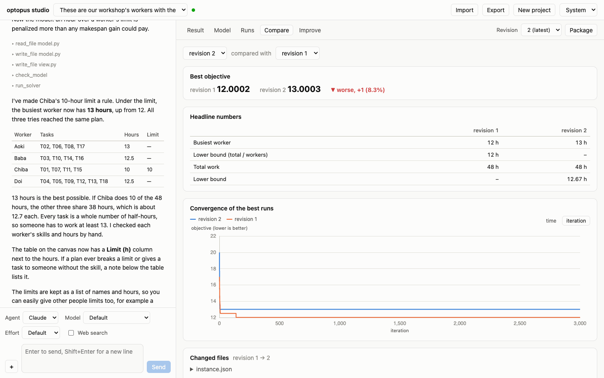

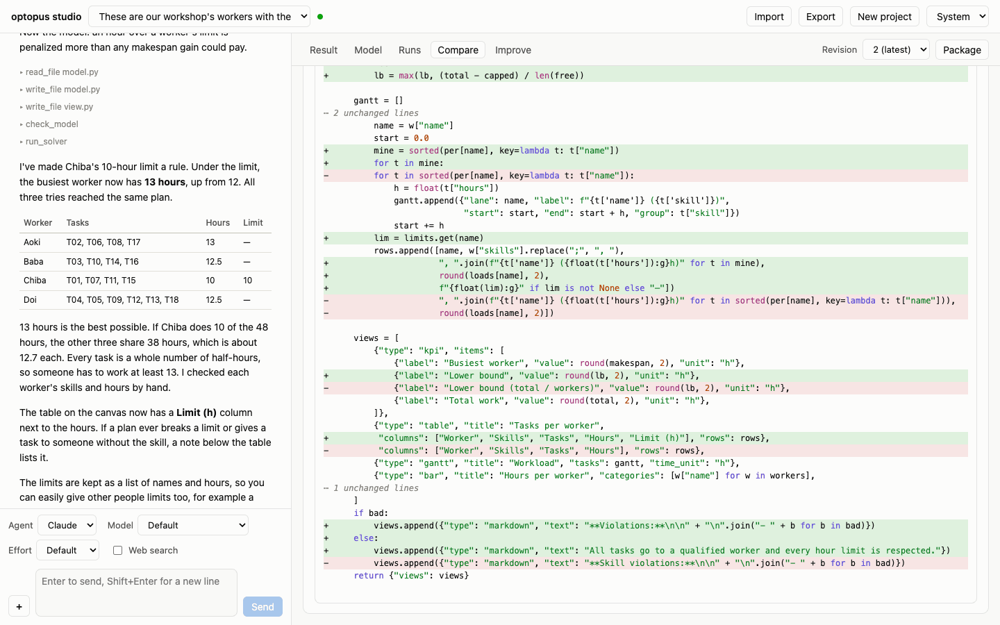

**起きること。** キャンバスが両方のリビジョンを取得し、ページの中で比べます。求解は行われません。
`view.py` や `app.json` だけを変えたリビジョンは、その前のものと同じように解けます。そのため最初の
比較ではそういうリビジョンを飛ばし、どれを飛ばしたかを表示します。

## 5. ヒューリスティックを比べる

**操作。** どの探索手法がこの問題に向いているかを尋ねます。

> Which search method suits this? Compare simulated annealing, tabu search and late acceptance
> hill climbing, 5 runs each.
>
> (どの探索手法が向いていますか。焼きなまし法、タブーサーチ、Late Acceptance Hill Climbing を
> それぞれ 5 ランずつ比べてください。)

**起きること。**

```
▸ api_help SimulatedAnnealing
▸ api_help LateAcceptanceHillClimbing
▸ write_file solve.json          3 つのヒューリスティックを、それぞれラベル付きで並べる
▸ check_model
▸ run_solver                     リビジョン 3 を作る
```

`solve.json` は、1 つの `"heuristic"` の代わりに、リストの `"heuristics"` を持つようになります。
それぞれが同じシードで 5 回ずつ走るので、3 つとも同じ解から始まり、違うのは探索のしかただけです。

**画面に出るもの。** **Convergence** に 3 つがヒューリスティックごとの色で重ねて描かれ、
**Heuristics** のカードにそれぞれの設定が並びます。**Runs** には、ヒューリスティックごとの最良・
平均・最悪の結果と平均時間の表が加わります。

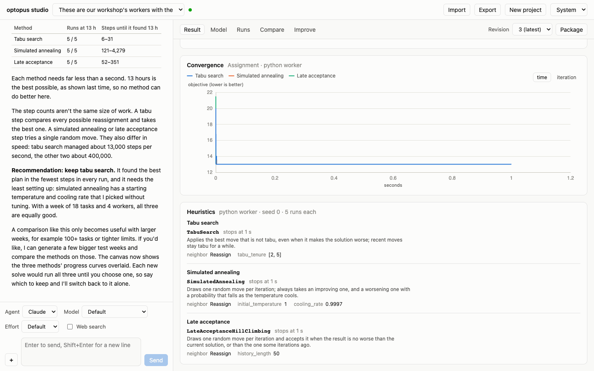

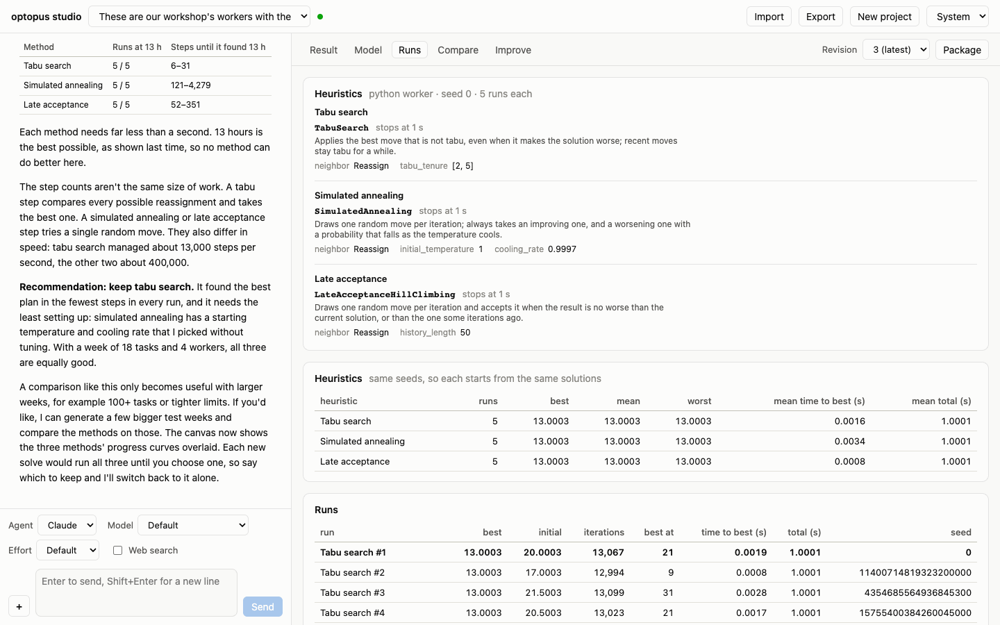

ここでは 3 つとも、すべてのランで 13 時間に達しました。18 個のタスクではどれを選んでも差が無く、
エージェントもそう答えます。小さなインスタンス 1 つでの比較ではこれ以上のことは分かりません。
そのためにあるのが[ステップ 8](#8-探索の改善をエージェントに任せる)です。

## 6. 自分の計画から始める

**操作。** **+** で `current-plan.csv` を添付して頼みます。

> Keep tabu search alone. This is the plan I made by hand: start from it, and tell me how much
> the search improves on it.
>
> (タブーサーチだけを残してください。これは私が手で作った計画です。ここから始めて、探索で
> どれだけ良くなるかを教えてください。)

**起きること。**

```
▸ preview_upload current-plan.csv
▸ import_upload current-plan.csv   計画を instance.json に入れる
▸ write_file model.py              ファイルの形の計画を読めるようにする
▸ write_file solve.json            "initial_solution": "current_plan"
▸ write_file view.py               自分の計画を結果の横に表示する
▸ check_model
▸ run_solver                       リビジョン 4 を作る
```

`solve.json` が `instance.json` の中の解を指定しない限り、どのランもランダムな解から始まります。
`"initial_solution"` があると各ランは自分の計画から始まるので、初期値は自分の計画の点数、最良値は
探索がそこからどこまで進んだかになります
([ADR 0011](../../adr/0011-start-from-a-solution-in-the-instance.md))。技能を持たない作業者に
タスクを与えているなど、問題に合わない計画は、求解を開始の段階で止め、理由を伝えます。同じ
仕組みで、以前の結果から探索を続けることもできます。「リビジョン 3 から続けて」と頼みます。

**画面に出るもの。** 手で作った計画では最も忙しい作業者が 14 時間で、探索はそれを 13 時間にします。
**Heuristic** のカードには "starts from instance.current_plan" と出て、**Runs** タブではすべてのランの
初期値が 14 になります。ビューはエージェントが書いたもので、ここでは表と棒グラフに自分の計画の時間を
加え、移動したタスクの一覧を付けました。

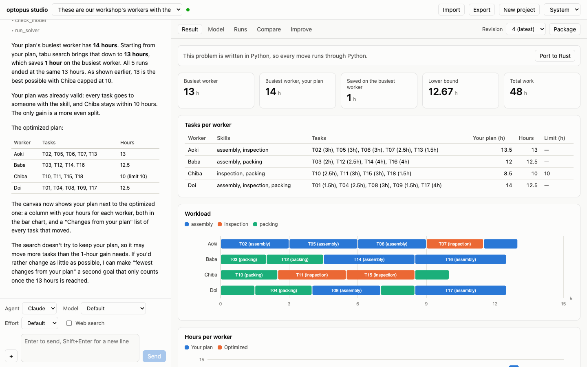

## 7. モデルを Rust に移植する

**操作。** Result タブの青いバナーにある **Port to Rust** をクリックします。

**起きること。** このボタンは、代わりに次のメッセージを送ります。"Port this model to Rust, verify it
against the Python model, and switch to the Rust worker if it passes."(このモデルを Rust に移植し、
Python のモデルと照合し、通れば Rust のワーカーに切り替えてください。)エージェントは次のように
進めます。

```
▸ rust_guide                     Python の問題を Rust にする方法を読む
▸ write_file rust/main.rs        同じモデルを Rust で書く
▸ build_rust                     コンパイルし、コンパイラのエラーを読む
▸ verify_rust                    両方のワーカーを同じシードで動かす
▸ write_file solve.json          "worker": "rust"
▸ run_solver                     リビジョン 5 を作る
```

Python で書いた問題は 1 手ごとに Python を呼び、1 秒に数千手しか進みません。移植は同じモデルを
コンパイルしたもので、安心して使えるのは `verify_rust` があるからです。移植が Python のモデルの解に
まったく同じ目的関数値を付けること、同じくらい良く探索すること、`view.py` がその結果を描けること、
そしてどれだけ速いかを確かめます。切り替えるのは、これに通った移植だけです。`model.py` は照合の基準と
してプロジェクトに残ります。これを変えた後は、エージェントが移植も同じように変えて照合し直します
([ADR 0005](../../adr/0005-rust-worker-as-a-verified-port.md))。

そのマシンでの最初のビルドは optopus 自体もコンパイルするので、2 回目以降より時間がかかります。
組み込み問題と `Formula` はもともと Rust で探索するので、バナーは出ません。

**画面に出るもの。** バナーが消え、**Convergence** と **Heuristic** に "rust worker" と出ます。今回の
セッションでは、Python の毎秒約 13,000 反復に対し、移植は毎秒約 587,000 反復でした。18 個のタスクでは
答えは変わりません。効いてくるのは、次のステップのようにインスタンスが大きくなったときです。

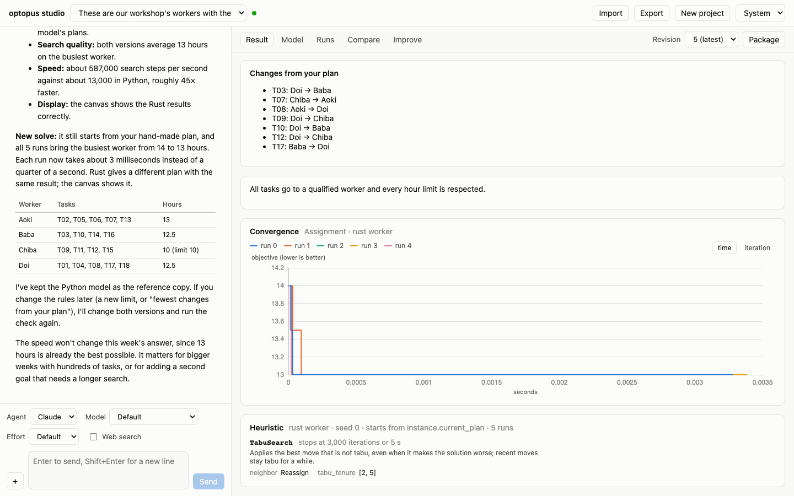

## 8. 探索の改善をエージェントに任せる

**操作。** 探索が何を得意になるべきか、エージェントがどれだけ作業してよいか、1 回の求解に
どれだけかけてよいかを伝えます。

> Next quarter we will plan the whole plant with this: about 12 workers and 150 tasks a week, a
> few of the workers part-time. Improve the search on your own on weeks of that size, for 3
> rounds; a solve may take 2 seconds.
>
> (来期はこれで工場全体を計画します。作業者は約 12 人、タスクは週に約 150 個で、何人かは
> パートタイムです。その規模の週について、3 ラウンドのあいだ自分で探索を改善してください。
> 1 回の求解は 2 秒までです。)

それから **Improve** を開いて見守ります。**Stop** を押すとキャンペーンを途中で終えられます。
エージェントに Web でも手法を調べさせたいときは、送る前にチャットの下の **Web search** に
チェックを入れます。既定ではオフです。

**起きること。** 1 つのインスタンスを 1 回解いただけでは、探索のことはほとんど分かりません。変更が
運で勝つことも、そのインスタンスにだけ合うこともあります。そこでエージェントはまず
**ベンチマーク**を作り、そのあとループを studio に渡します。studio が**キャンペーン**を進めます
([ADR 0019](../../adr/0019-drive-the-improvement-loop-from-the-studio.md))。以下は抜粋です。

```
▸ write_file generate.py         頼まれた規模の週を作る
▸ bench_add plant_s1             ベンチマークのインスタンス(全部で 7 つ)
▸ bench_settings                 インスタンスごとに 5 ラン、各 2 秒
▸ run_solver                     リビジョン 6。キャンペーンの出発点になる探索
▸ improve_start                  ループを studio に渡す
studio: Improvement campaign, round 1 of 3
▸ diagnose                       今の探索のどこが足りないか
▸ read_docs recipes              この種の問題で効くと報告されている手法
▸ profile                        複数のヒューリスティックをベンチマークで並べて調べる
▸ candidate_save                 変更を 1 つ、確かめたい仮説と一緒に保存する(4 回)
▸ race                           候補をリビジョン 6 と同じシードでレースさせる
▸ candidate_lesson               それぞれの結果から分かったこと
studio: Improvement campaign, round 2 of 3
  …
▸ adopt                          勝った候補を新しいリビジョンとして解く
studio: The campaign ended after 3 rounds and 11 minutes
```

- **ベンチマーク**のインスタンスは 3 種類あります。変更をレースさせるのは **train** です。
  **validation**(検証用)は最後の確認のために取っておき、**test** は最終結果を測るだけで、
  どの選択にも使いません。ここでは小さな 1 週間だけでは判定できないので、エージェントが
  `generate.py` を書いて、頼まれた規模の週を作りました。
- **ラウンドを進めるのは studio で、エージェントではありません。** `studio:` で始まる行は、studio が
  エージェントに送ったメッセージです。キャンペーンの現在地、試したことの台帳、そのラウンドで
  することが書かれています。クリックすると読めます。エージェントは 1 ラウンドにつき 1 回作業します。
- **1 ラウンドの中で**、エージェントは今の探索を診断し、種類の違う 3〜4 個の変更を、それぞれが
  確かめる仮説と一緒に**候補**として保存し、レースさせます。すべての候補と現在のリビジョンが、
  train の全インスタンスを同じシード・同じ予算で解き、対応のある検定が各候補に判定を付けます。
  better、mixed、same、worse、rejected、failed のいずれかです
  ([それぞれの意味](projects.md#アルゴリズムを改善する))。
- **採用できるのは better と判定された候補だけ**で、採用するとそれが新しいリビジョンとして
  解かれます。予算は各ヒューリスティック自身の停止条件に置き換わるので、長く走ることで勝つことは
  できません。また、現在のリビジョンのモデルが候補の解を採点し直すので、最適化の対象を変えて
  勝つこともできません。
- **キャンペーンが終わる**のは、ラウンド数か時間を使い切ったとき、3 ラウンド続けて成果が
  無かったとき、**Stop** を押したときです。そのあと studio 自身が結果を確かめます。最終の
  リビジョンを出発点のリビジョンと、検証用インスタンスで比べます。そこでも改善が成り立つときだけ
  残し、そうでなければファイルを出発点のリビジョンのものに戻します。

**画面に出るもの。** **Improve** タブが進行に合わせて更新され、レースや診断の実行中は進捗バーが
出ます。ラウンド 1 の途中では、ベンチマーク、キャンペーンの状態、最初の診断とその読み取り、
プロファイルが表示されていました。

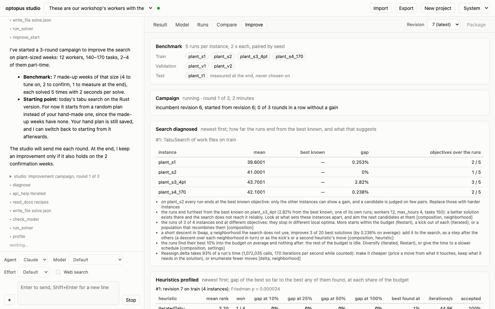

今回のセッションは次のように進みました。アイデアよりも判定のほうが大事である理由が分かります。

- **ラウンド 1** では 4 つの変更をレースさせました。長いタブーリスト、反復タブーサーチ、
  焼きなまし法、可変近傍探索です。4 つとも "same" でした。理由はエージェントが記録した教訓に
  あります。これらの週ではどの手法も数ミリ秒で同じ時間に達し、現在の探索も 20 ラン中 17 ランで
  そこに達していたので、ベンチマークでは探索の優劣を見分けられなかったのです。
- **ラウンド 2**: そこでエージェントはまずベンチマークを難しくしました(同じ技能を持つ作業者が
  少ない週、15 分単位のタスク)。すると 3 つの候補が better と判定され、最も良かったもの、
  150 タスク向けに調整した反復タブーサーチが、リビジョン 8 として採用されました。
- **ラウンド 3** では、リビジョン 8 に対する 3 つの変更をレースさせました。better は無く、
  何も採用されませんでした。
- **最後の確認**: リビジョン 8 はリビジョン 6 に対して、validation で better(+2.74%)、test で
  same(+0.23%)だったので、studio はこれを残しました。

キャンペーンが終わると、タブの **Campaign** の行に結果が出ます。**Hypotheses** にはすべての候補が、
変更の種類、変更の対象のリビジョン、走ったレース、その結末、ゲイン、エージェントが引き出した
教訓と一緒に並びます。

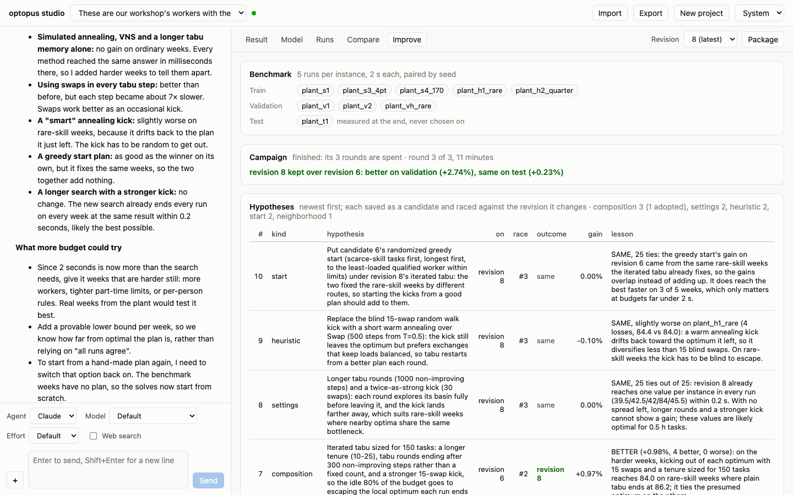

その下の **Changes judged** には評価ごとに 1 行があり、判定と、良くなった・変わらない・悪くなった
インスタンスの数が出ます。行をクリックするとインスタンスごとの値が見られます。一番上の 2 行は、
studio 自身による最後の確認です。

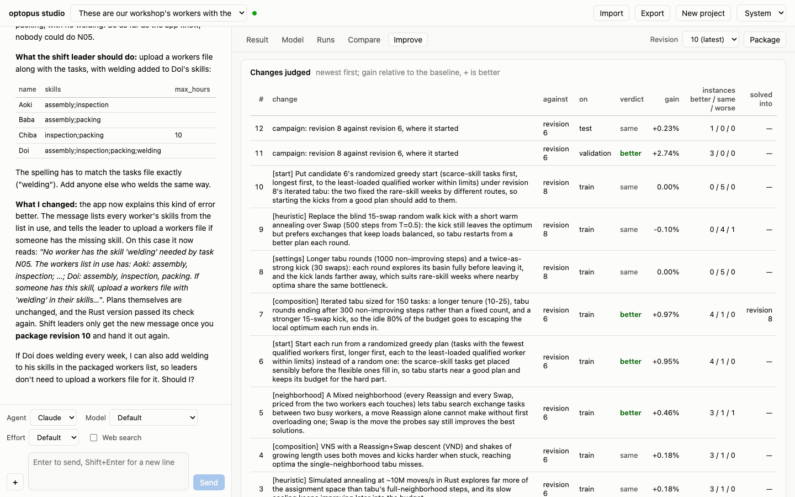

エージェントは最後に、利用者の言葉でまとめます。探索がどれだけ、どのインスタンスで良くなったか、
何が効いたか、何が効かず、それはなぜか、です。新しいリビジョンがすべて改善というわけでは
ありません。ここでのリビジョン 7 は、プロファイルのために 6 つのヒューリスティックを並べて解いた
ものです。調整・プロファイル・診断の詳細は[アルゴリズムを改善する](projects.md#アルゴリズムを改善する)に、
タブの各列の意味は[画面の説明](interface.md#improve)にあります。

## 9. アプリにする

**操作。** 誰が使い、何を持ち込み、何を設定できるかを伝えます。

> Make this an app for the shift leaders: each week they upload that week's tasks, and the
> workers when they change, and they can set how many seconds a solve may take.
>
> (これをシフトリーダー向けのアプリにしてください。毎週その週のタスクをアップロードし、
> 作業者が変わったときは作業者もアップロードし、1 回の求解に何秒かけるかを設定できるように
> してください。)

エージェントの作業が終わったら、**Revision** メニューでエージェントが挙げたリビジョン(その後
解き直していなければ最新のもの)を選び、**Package** をクリックします。

**起きること。**

```
▸ write_file model.py            渡されたデータを確かめ、何がおかしいかを伝える
▸ write_file rust/main.rs        同じ変更を移植にも
▸ build_rust
▸ write_file instance.json       上限を作業者の表に移す
▸ write_file view.py
▸ write_file app.json            アプリの利用者が差し替えられるもの、設定できるもの
▸ check_app                      app.json をデータと設定に照らして確かめる
▸ check_model
▸ verify_rust                    移植が Python のモデルと今も一致するか
▸ write_file solve.json          1 回の求解につき 1 ラン
▸ check_app
▸ run_solver                     リビジョン 9。app.json を含む
```

`app.json` は **inputs** と **parameters** を挙げます。inputs は、`instance.json` の表のうち
アプリの利用者が自分のファイルで差し替えられるもので、それぞれに必要な列が書かれます。
parameters は利用者が設定できる個々の値で、それぞれに範囲が付きます。それ以外はパッケージした
ときのままです。アプリの利用者は求解が失敗した理由をエージェントに聞けないので、エージェントは
`model.py` に、データについての前提を確かめ、何がおかしいかを利用者の言葉で伝える処理も加えます。
ここではさらに、パートタイムの上限を作業者の表の `max_hours` 列に移しました。シフトリーダーが
同じファイルで変えられるようにするためです。

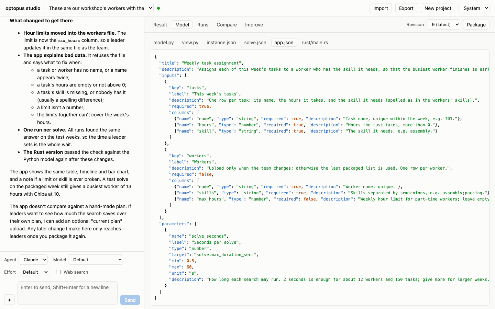

**Package** は `optopus-app-<project>-r<rev>.zip` をダウンロードします。リビジョンのファイルと、
見本としてそのリビジョン自身の結果が入っています。`app.json` の無いリビジョンや、`app.json` が
合っていないリビジョンでは、代わりに黄色の "Cannot package revision N" というバナーが出て、
理由を伝えます([ADR 0009](../../adr/0009-package-a-revision-as-an-app.md))。

**画面に出るもの。** ダウンロードフォルダに zip ができます(Safari はフォルダに展開しますが、
それでも動きます)。このリポジトリのチェックアウトから、エージェントもログインも無しで動かせます。

```bash
uv run optopus-studio app optopus-app-<project>-r<rev>.zip   # http://127.0.0.1:8766
```

## 10. アプリを使う

このステップはシフトリーダーの側で、上のアドレスで行います。チャットもエージェントもありません。

**操作。** アプリを開くと、何が得られるかが分かるように、パッケージされたデータでの結果が
表示されます。**Data** の "This week's tasks" で **Choose file** をクリックし、
[`tasks-next-week.csv`](../../guide/walkthrough/tasks-next-week.csv) を渡します(アプリの
タイトル、ラベル、説明は、エージェントが `app.json` に書いたものです)。必要なら
**Settings** の **Seconds per solve** を設定し、**Solve** をクリックします。

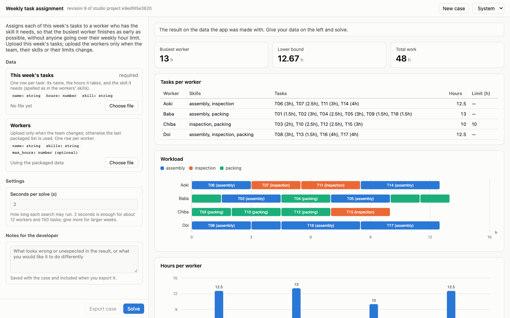

**起きること。** アプリはファイルを studio の `import_upload` と同じように読み、その行を
パッケージされた表の代わりに置き、設定を反映して、パッケージされたモデルと探索で解きます。求解は
専用のプロセスで行われます。解く前に、各ファイルを `app.json` が挙げる列に照らして確かめます。
列が足りない、セルが空である、形式が違うといった問題は、"These inputs cannot be solved as they
are" の下に行番号付きで報告されます。渡さなかった入力にはパッケージされたデータが使われます。
ここでは作業者がそうです。

**画面に出るもの。** この週には welding(溶接)のタスクがあり、パッケージされた一覧には溶接の
できる作業者がいません。モデル自身のチェックが求解を止め、エージェントが用意した言葉でそう伝えます。

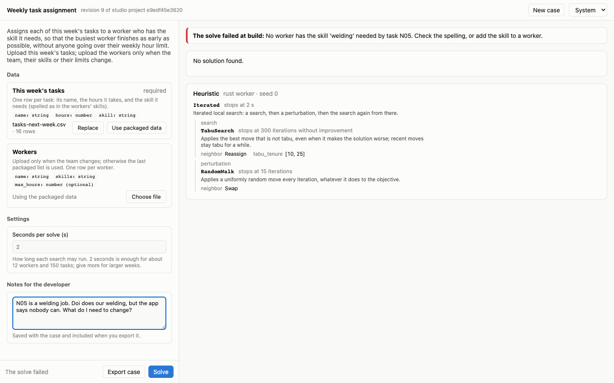

シフトリーダーは Doi が溶接できることを知っていますが、何を変えればよいかは分かりません。そこで
それを **Notes for the developer** に書き、**Export case** をクリックします。
`optopus-case-<id>.zip` がダウンロードされます。渡したファイル、設定、アプリがそこから作ったもの、
そしてメモが入っています。この zip を開発者に送ります。それ以外のものがマシンの外に出ることは
ありません。ケースはそのマシンに残り、**New case** で別のケースを始められます。

## 11. ケースを持ち帰る

**操作。** studio に戻り、ケースの zip を他のファイルと同じように **+** で添付します。チップには
`case:<id>` と表示されます。そして尋ねます。

> A shift leader sent this case from the app. What went wrong?
>
> (シフトリーダーがアプリからこのケースを送ってきました。何が問題でしたか。)

**起きること。**

```
▸ read_case                      ケースの出どころ、何が失敗したか、データとメモ
▸ load_case                      プロジェクトのデータをケースのデータに置き換える
▸ check_model                    失敗を再現する
▸ restore_revision               リビジョン 9 のファイルに戻す
▸ write_file model.py            この種のデータに対する、より分かりやすいメッセージ
▸ write_file rust/main.rs
▸ build_rust
▸ load_case
▸ check_model                    ケースが新しいメッセージで失敗することを確かめる
▸ write_file instance.json       パッケージされたデータに戻す
▸ verify_rust
▸ check_app
▸ run_solver                     リビジョン 10
```

ケースはプロジェクトの `cases/` フォルダに保存されます。`read_case` は、アプリがどのリビジョンから
パッケージされたか、アプリが何を受け付けなかったか、あるいは求解がどう失敗したかをエージェントに
伝えます。`load_case` はプロジェクトのデータをケースのデータにするので、エージェントはアプリの
利用者が見たのと同じ失敗を見ます。そのうえで、原因がデータにあるのかモデルにあるのかを伝えます。
解けはしたが、メモに「期待した結果ではない」と書かれているケースは、失敗ではなくフィードバックです。
エージェントはモデルがどの要件を満たしていないかを突き止め、何かを変える前に確認を求めます。

**画面に出るもの。** ここでの答えは、原因はデータにあり、それがどこか、です。タスクのファイルは
正しいが、アプリはパッケージされた作業者の一覧を使い、その中に溶接のできる人がいませんでした。
シフトリーダーは、Doi の技能に `welding` を加えた作業者のファイル
([`workers-next-week.csv`](../../guide/walkthrough/workers-next-week.csv))をアップロードする
必要があります。エージェントは、次からはメッセージ自身がそう伝えるようにもしました。それが
リビジョン 10 です。

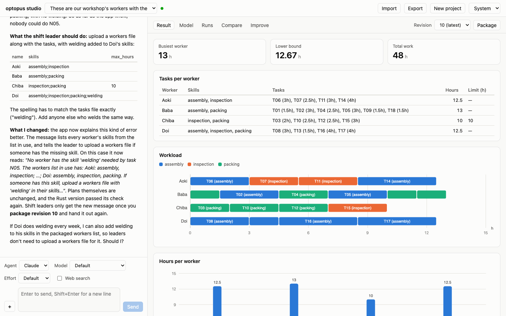

修正がアプリの利用者に届くのは、そのリビジョンをもう一度パッケージして配ったときです。アプリに
戻り、シフトリーダーが作業者のファイルも渡すと、その週が解けます。

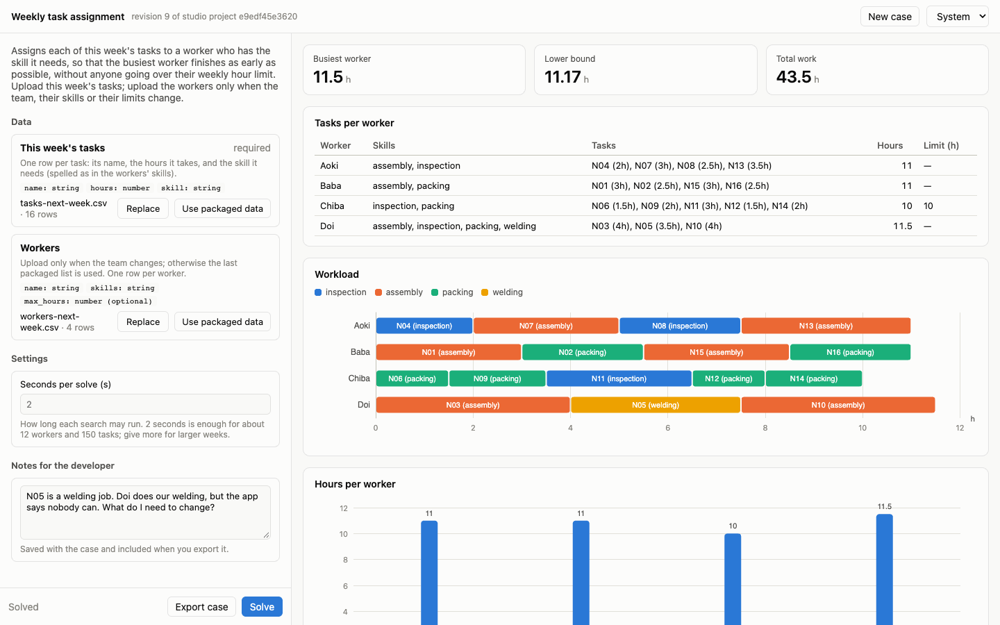

## 12. 渡す

作ったものを渡す方法は、受け取る相手によって 3 つあります。

**studio で作業を続ける同僚に。** ヘッダーの **Export** をクリックします。プロジェクトが 1 つの zip で
ダウンロードされます。チャット、結果とビュー付きの全リビジョン、添付ファイル、そしてベンチマークと
そこで判定したものすべてが入ります。受け取った人は **Import** をクリックして zip を選びます。
"(imported)" と付いた新しいプロジェクトとして追加されます。エージェントのセッションは実行したマシンに
残るので、受け取った側のエージェントは新しいセッションを始め、まず会話を読みます
([ADR 0007](../../adr/0007-share-a-project-as-a-zip.md))。

**このリポジトリはあるがエージェントは無い人に。** [ステップ 9](#9-アプリにする) のパッケージを
`uv run optopus-studio app <zip>` で動かします。Claude Code や Codex のログインは要りません。

**どちらも無い顧客に。** パッケージを Docker イメージにします。アプリ、ソルバー、ビルド済みの Rust
移植が入り、エージェントは入りません
([ADR 0010](../../adr/0010-deliver-an-app-as-a-docker-image.md))。

```bash
uv run optopus-studio image optopus-app-<project>-r<rev>.zip --save app-r<rev>.tar
```

顧客は Docker だけで読み込んで実行できます。コマンドは
[README](https://github.com/trash-iine/optopus-studio/blob/main/README.md#handing-an-app-to-a-customer)(英語)にあります。顧客のケースは顧客の
マシンに残り、こちらに届くのはエクスポートされたファイルだけです。

エージェントそのものを替えることもできます。チャットの下の **Agent** メニューで、エージェントが作業して
いないときに、プロジェクトを Claude と Codex の間で切り替えられます。切り替えた先のエージェントは、
次のメッセージでそれまでの会話を読み、プロジェクトのファイルから続けます。**Model** と **Effort** では、
エージェント自身が返す一覧から、エージェントが使うモデルと考える量を選びます。

## どこに何が残るか

ここまでのものはすべて自分のマシンの `~/.optopus-studio/projects/<id>/`(または
`OPTOPUS_STUDIO_HOME`)の下にあります。

| フォルダ | 中身 | 書かれるステップ |
|---|---|---|
| `uploads/` | 添付したファイル | ステップ 1 と 6 |
| `work/` | エージェントが編集中のファイル | すべてのステップ |
| `revs/<n>/` | 求解ごとに、解いたときのファイルと `result.json`・`view.json` | `run_solver` のたび |
| `bench/` | ベンチマーク、候補、すべての評価・調整・プロファイル・診断 | ステップ 8 |
| `cases/<id>/` | アプリから添付したケース | ステップ 11 |
| `chat.jsonl` | 会話 | メッセージのたび |

## 次に読むもの

- [画面の説明](interface.md): 画面上のすべての部品。このページで触れなかったものも含みます。
- [プロジェクト・リビジョン・ファイル](projects.md): ファイルの詳細と、
  [探索の変更がどう判定されるか](projects.md#アルゴリズムを改善する)。
- [トラブルシューティング](troubleshooting.md): ここに書いたとおりに進まないとき。
